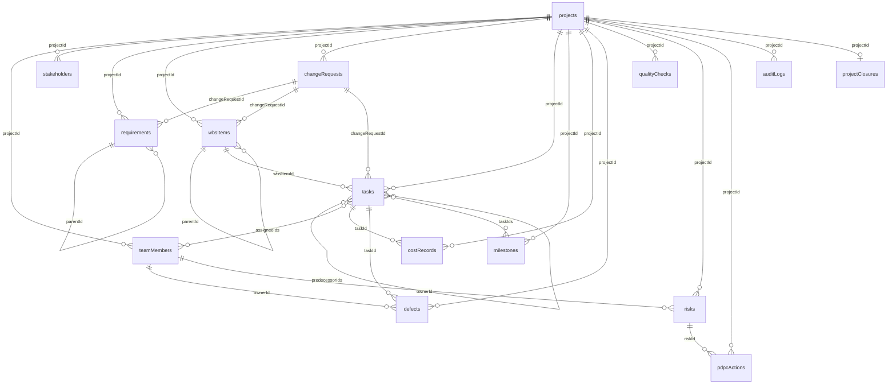

# MongoDB Atlas database schema

Persistent storage for the Smart Healthcare Project Management System. Everything in this
file after the introduction is generated from the real Mongoose schemas and a real seeded
database by `npm run docs:schema`; all names, hospitals, people and amounts are fictional.

## 1. Connecting to MongoDB Atlas (`MONGO_URI`)

1. Atlas → **Database Access** → create a database user and note the password.
2. Atlas → **Network Access** → **Add IP Address** → your IP (or `0.0.0.0/0` for a demo).
3. Atlas → **Clusters → Connect → Drivers** → copy the connection string.
4. Create `backend/.env` (copy `.env.example`, or run `npm run setup` and paste the string):

```
MONGO_URI=mongodb+srv://<db_user>:<db_password>@<cluster-host>.mongodb.net/smart_healthcare?retryWrites=true&w=majority&appName=Cluster0
JWT_SECRET=<random string, 32+ characters>
SEED_PASSWORD=<demo login password, 10+ characters>
```

Replace `<db_password>` with the real password **without** the `<` `>` brackets. If the password
contains characters such as `@ : / ? #`, URL-encode them. `backend/.env` is git-ignored; only
`.env.example` (placeholders) is committed. Never put a real password in code, docs or screenshots.
The older variable name `MONGODB_URI` is still read when `MONGO_URI` is absent.

```
npm install
npm run db:check    # connection test + document count per collection
npm run seed        # safe, idempotent: creates the demo project once, never overwrites
npm run dev         # API :4000, UI :5173
```

If the SRV DNS lookup is blocked by a network, the server retries with Google DNS automatically.

## 2. Design rules

* **One collection per entity** (15 collections + `users`). Every project-related document has
  `projectId` (ObjectId → `projects`) and a human-readable `code` (e.g. `T-03`, `REQ-006`).
  `{projectId, code}` is unique, so codes cannot repeat inside a project.
* **Relationships use ObjectId references** (`ref`), never copied names. Section 4 lists all of them.
  Model-level checks reject a reference to a record that does not exist in the *same* project and
  self-references (a task cannot precede itself, a WBS item cannot be its own parent).
* **Hierarchy:** `requirements.parentId` and `wbsItems.parentId` point at the same collection.
  Both also carry `changeRequestId`, linking scope that exists only because of a change request.
* **Tasks:** `predecessorIds` (array of task ObjectIds, finish-to-start) and `assigneeIds`
  (array of team-member ObjectIds). The API adds cycle and date-order checks.
* **Validation:** `strict: "throw"` (unknown fields are rejected), required fields, enums, numeric
  ranges, whole-number weeks, risk likelihood/impact 1–5, task end ≥ start, completed ⇔ 100 %,
  a defect cannot be Closed without verification `Passed`, email format, `timestamps: true`.
* **Baselines are separate.** `projects.originalBaseline` (PKR 5,000,000, 16 weeks) is declared
  `immutable`; Mongoose ignores/rejects any later write. `projects.currentBaseline` starts equal to
  it and changes only when a change request is approved.
* **Approval is atomic and applied once** (`store.decideChange`):
  1. `changeRequests.findOneAndUpdate({code, status: "Pending"}, {status: "Approved", decision…})` —
     only one caller can win; every other caller (double-click, retry, parallel request) matches nothing
     and receives HTTP 409.
  2. The winner promotes linked requirements/WBS items to Approved.
  3. `projects.updateOne({appliedChangeIds: {$ne: changeId}}, {$inc: {currentBaseline.budget, currentBaseline.weeks}, $push: {appliedChangeIds: changeId}})`
     — the `$ne` guard makes this step idempotent, so even a retry cannot add the cost or weeks twice.
  4. An audit-log entry is appended.
  On Atlas (a replica set) steps 1–4 run in one multi-document **transaction**. On a standalone server
  the same guards apply, and `reconcileBaseline()` (run at start-up and by `npm run seed`) finishes any
  approved-but-unapplied request exactly once. `baselineIntegrity()` checks stored baseline =
  original + approved changes.
* **Decided change requests are immutable** (cost/weeks cannot be edited, including by query updates).
  `auditLogs` is append-only (updates and deletes throw). Task baselines (`baseline.*`) are written once.
* **Concurrency:** `projects.revision` is a version counter. API writes carry the version they read;
  a stale write returns HTTP 409 and nothing is written.

## 3. Entity relationships



## 4. Reference list (every ObjectId relationship)

| From (collection.field) | To | Cardinality | |
|---|---|---|---|
| every project-scoped collection.projectId | projects | many → one | required |
| projects.managerId | TeamMember | one | optional |
| projects.appliedChangeIds | ChangeRequest | many | optional |
| requirements.parentId | Requirement | one | optional |
| requirements.changeRequestId | ChangeRequest | one | optional |
| requirements.ownerId | TeamMember | one | optional |
| wbsItems.parentId | WbsItem | one | optional |
| wbsItems.changeRequestId | ChangeRequest | one | optional |
| wbsItems.ownerId | TeamMember | one | optional |
| tasks.wbsItemId | WbsItem | one | optional |
| tasks.changeRequestId | ChangeRequest | one | optional |
| tasks.assigneeIds | TeamMember | many | optional |
| tasks.predecessorIds | Task | many | optional |
| milestones.taskIds | Task | many | optional |
| costRecords.taskId | Task | one | required |
| defects.ownerId | TeamMember | one | optional |
| defects.taskId | Task | one | optional |
| qualityChecks.ownerId | TeamMember | one | optional |
| risks.ownerId | TeamMember | one | optional |
| pdpcActions.ownerId | TeamMember | one | optional |
| pdpcActions.riskId | Risk | one | optional |

## 5. Collections, fields and sample documents

### projects  (Mongoose model `Project`)

| Field | Type | Reference | Rules |
|---|---|---|---|
| `_id` | ObjectId | | primary key |
| `name` | String |  | required; unique; max length 120 |
| `description` | String |  |  |
| `manager` | String |  |  |
| `managerId` | ObjectId | → TeamMember |  |
| `hospitals` | Array<Subdocument> |  |  |
| `hospitals[].code` | String |  | required |
| `hospitals[].name` | String |  | required |
| `hospitals[].city` | String |  |  |
| `objectives` | String |  |  |
| `businessNeed` | String |  |  |
| `scope` | String |  |  |
| `deliverables` | String |  |  |
| `assumptions` | String |  |  |
| `constraints` | String |  |  |
| `plan` | Map |  |  |
| `plan.$*` | String |  |  |
| `startDate` | Date |  | required |
| `status` | String |  | enum: Planning / In Progress / On Hold / Completed; default "Planning" |
| `threshold` | Number |  | min 0; max 1; default 0.9 |
| `originalBaseline.budget` | Number |  | required; immutable; min 0 |
| `originalBaseline.weeks` | Number |  | required; immutable; min 1; whole number |
| `originalBaseline.approvedAt` | Date |  | immutable; default now |
| `currentBaseline.budget` | Number |  | required; min 0 |
| `currentBaseline.weeks` | Number |  | required; min 1; whole number |
| `currentBaseline.lastAppliedAt` | Date |  |  |
| `appliedChangeIds` | Array<ObjectId> | → ChangeRequest |  |
| `revision` | Number |  | min 0; default 0 |
| `createdAt`, `updatedAt` | Date | | automatic timestamps |

**Indexes:** `{name:1} unique`, `{status:1}`

**Sample document**
```json
{
  "_id": {
    "$oid": "6add909f45ad9d2801201e18"
  },
  "name": "Smart Healthcare Project",
  "description": "Healthcare Management System for 5 Hospitals",
  "manager": "Ayesha Khan",
  "hospitals": [
    {
      "code": "H-01",
      "name": "Lahore Central Hospital"
    },
    {
      "code": "H-02",
      "name": "City Care Hospital"
    },
    {
      "code": "H-03",
      "name": "Hope Medical Centre"
    },
    {
      "code": "H-04",
      "name": "Green Valley Hospital"
    },
    {
      "code": "H-05",
      "name": "Community General Hospital"
    }
  ],
  "objectives": "Improve patient record accuracy. Reduce appointment conflicts. Deliver reliable hospital reporting.",
  "businessNeed": "Coordinate the delivery of one healthcare platform across five hospitals.",
  "scope": "Patient registration, records, appointments, staff and reporting.",
  "deliverables": "Web application, integrated database, test evidence, deployment and training.",
  "assumptions": "Hospital stakeholders are available for fortnightly reviews.",
  "constraints": "Original budget PKR 5,000,000; original duration 16 weeks.",
  "plan": {
    "Scope": "Baseline requirements require approval. Proposed features remain outside scope.",
    "Schedule": "Calendar days, finish-to-start dependencies, weekly review.",
    "Cost": "Track actual transactions against immutable task cost baselines.",
    "Quality": "Critical defects require retesting before closure.",
    "Risk": "Review risk register weekly.",
    "Resource": "Seven team members with named task ownership.",
    "Communication": "Weekly progress report to hospital stakeholders.",
    "Change": "Project Manager records approval and justification before scope changes.",
    "Closure": "Record acceptance, final cost, open issues and lessons learned."
  },
  "startDate": {
    "$date": "2026-09-01T00:00:00Z"
  },
  "status": "In Progress",
  "threshold": 0.9,
  "originalBaseline": {
    "budget": 5000000,
    "weeks": 16,
    "approvedAt": {
      "$date": "2026-10-25T05:16:15.264Z"
    }
  },
  "currentBaseline": {
    "budget": 5000000,
    "weeks": 16
  },
  "appliedChangeIds": [],
  "revision": 0,
  "createdAt": {
    "$date": "2026-10-25T05:16:15.270Z"
  },
  "updatedAt": {
    "$date": "2026-10-25T05:16:15.270Z"
  },
  "__v": 0
}
```

### teamMembers  (Mongoose model `TeamMember`)

| Field | Type | Reference | Rules |
|---|---|---|---|
| `_id` | ObjectId | | primary key |
| `projectId` | ObjectId | → Project | required; immutable |
| `code` | String |  | required; immutable |
| `name` | String |  | required |
| `role` | String |  |  |
| `email` | String |  | lowercase |
| `status` | String |  | enum: Active / On Leave; default "Active" |
| `createdAt`, `updatedAt` | Date | | automatic timestamps |

**Indexes:** `{projectId:1}`, `{projectId:1,code:1} unique`, `{projectId:1,email:1} unique (partial: non-empty email)`

**Sample document**
```json
{
  "_id": {
    "$oid": "6add909f45ad9d2801201e1c"
  },
  "projectId": {
    "$oid": "6add909f45ad9d2801201e18"
  },
  "code": "PM-01",
  "name": "Ayesha Khan",
  "role": "Project Manager",
  "status": "Active",
  "createdAt": {
    "$date": "2026-10-25T05:16:15.306Z"
  },
  "updatedAt": {
    "$date": "2026-10-25T05:16:15.306Z"
  },
  "__v": 0
}
```

### stakeholders  (Mongoose model `Stakeholder`)

| Field | Type | Reference | Rules |
|---|---|---|---|
| `_id` | ObjectId | | primary key |
| `projectId` | ObjectId | → Project | required; immutable |
| `code` | String |  | required; immutable |
| `name` | String |  | required |
| `role` | String |  |  |
| `organization` | String |  |  |
| `email` | String |  | lowercase |
| `description` | String |  |  |
| `influence` | String |  | enum: High / Medium / Low |
| `interest` | String |  | enum: High / Medium / Low |
| `createdAt`, `updatedAt` | Date | | automatic timestamps |

**Indexes:** `{projectId:1}`, `{projectId:1,code:1} unique`

**Sample document**
```json
{
  "_id": {
    "$oid": "6add909f45ad9d2801201e23"
  },
  "projectId": {
    "$oid": "6add909f45ad9d2801201e18"
  },
  "code": "ST-01",
  "name": "Hospital steering committee",
  "role": "Sponsor",
  "description": "Representatives from five fictional hospitals",
  "createdAt": {
    "$date": "2026-10-25T05:16:15.320Z"
  },
  "updatedAt": {
    "$date": "2026-10-25T05:16:15.320Z"
  },
  "__v": 0
}
```

### requirements  (Mongoose model `Requirement`)

| Field | Type | Reference | Rules |
|---|---|---|---|
| `_id` | ObjectId | | primary key |
| `projectId` | ObjectId | → Project | required; immutable |
| `code` | String |  | required; immutable |
| `title` | String |  | required |
| `description` | String |  |  |
| `category` | String |  |  |
| `priority` | String |  | enum: High / Medium / Low |
| `status` | String |  | enum: Proposed / Approved / In Progress / Completed / Rejected; default "Proposed" |
| `source` | String |  |  |
| `effort` | Number |  | min 0 |
| `parentId` | ObjectId | → Requirement |  |
| `changeRequestId` | ObjectId | → ChangeRequest |  |
| `ownerId` | ObjectId | → TeamMember |  |
| `createdAt`, `updatedAt` | Date | | automatic timestamps |

**Indexes:** `{projectId:1}`, `{projectId:1,code:1} unique`, `{projectId:1,parentId:1}`, `{projectId:1,changeRequestId:1}`, `{projectId:1,status:1}`

**Sample document**
```json
{
  "_id": {
    "$oid": "6add909f45ad9d2801201e2a"
  },
  "projectId": {
    "$oid": "6add909f45ad9d2801201e18"
  },
  "code": "REQ-001",
  "title": "Patient registration",
  "description": "Patient registration",
  "category": "Functional",
  "priority": "High",
  "status": "Approved",
  "source": "Hospital steering committee",
  "effort": 40,
  "createdAt": {
    "$date": "2026-10-25T05:16:15.326Z"
  },
  "updatedAt": {
    "$date": "2026-10-25T05:16:15.326Z"
  },
  "__v": 0
}
```

### wbsItems  (Mongoose model `WbsItem`)

| Field | Type | Reference | Rules |
|---|---|---|---|
| `_id` | ObjectId | | primary key |
| `projectId` | ObjectId | → Project | required; immutable |
| `code` | String |  | required; immutable |
| `title` | String |  | required |
| `description` | String |  |  |
| `status` | String |  | enum: Proposed / Approved / Rejected; default "Proposed" |
| `effort` | Number |  | min 0 |
| `parentId` | ObjectId | → WbsItem |  |
| `changeRequestId` | ObjectId | → ChangeRequest |  |
| `ownerId` | ObjectId | → TeamMember |  |
| `createdAt`, `updatedAt` | Date | | automatic timestamps |

**Indexes:** `{projectId:1}`, `{projectId:1,code:1} unique`, `{projectId:1,parentId:1}`, `{projectId:1,changeRequestId:1}`

**Sample document**
```json
{
  "_id": {
    "$oid": "6add909f45ad9d2801201e31"
  },
  "projectId": {
    "$oid": "6add909f45ad9d2801201e18"
  },
  "code": "1",
  "title": "Project Management",
  "status": "Approved",
  "createdAt": {
    "$date": "2026-10-25T05:16:15.332Z"
  },
  "updatedAt": {
    "$date": "2026-10-25T05:16:15.332Z"
  },
  "__v": 0
}
```

### changeRequests  (Mongoose model `ChangeRequest`)

| Field | Type | Reference | Rules |
|---|---|---|---|
| `_id` | ObjectId | | primary key |
| `projectId` | ObjectId | → Project | required; immutable |
| `code` | String |  | required; immutable |
| `title` | String |  | required |
| `description` | String |  |  |
| `reason` | String |  |  |
| `requester` | String |  |  |
| `requestDate` | Date |  |  |
| `priority` | String |  | enum: High / Medium / Low |
| `scopeImpact` | String |  |  |
| `riskImpact` | String |  |  |
| `costImpact` | Number |  | required; read-only once decided; min 0 |
| `scheduleImpactWeeks` | Number |  | required; read-only once decided; min 0; whole number |
| `status` | String |  | enum: Pending / Approved / Rejected; default "Pending" |
| `decision.by` | String |  |  |
| `decision.at` | Date |  |  |
| `decision.comments` | String |  |  |
| `appliedToBaseline` | Boolean |  | default false |
| `appliedAt` | Date |  |  |
| `createdAt`, `updatedAt` | Date | | automatic timestamps |

**Indexes:** `{projectId:1}`, `{projectId:1,code:1} unique`, `{projectId:1,status:1}`

**Sample document**
```json
{
  "_id": {
    "$oid": "6add909f45ad9d2801201e3a"
  },
  "projectId": {
    "$oid": "6add909f45ad9d2801201e18"
  },
  "code": "CR-001",
  "title": "AI diagnosis assistance & mobile application",
  "description": "Preliminary assistance only, not a replacement for professional medical diagnosis.",
  "reason": "Improve access and assist clinical triage.",
  "requester": "Hospital steering committee",
  "requestDate": {
    "$date": "2026-10-20T00:00:00Z"
  },
  "priority": "High",
  "scopeImpact": "Add AI preliminary assistance and mobile application.",
  "riskImpact": "AI reliability and privacy require additional review.",
  "costImpact": 800000,
  "scheduleImpactWeeks": 3,
  "status": "Pending",
  "appliedToBaseline": false,
  "createdAt": {
    "$date": "2026-10-25T05:16:15.337Z"
  },
  "updatedAt": {
    "$date": "2026-10-25T05:16:15.337Z"
  },
  "__v": 0
}
```

### tasks  (Mongoose model `Task`)

| Field | Type | Reference | Rules |
|---|---|---|---|
| `_id` | ObjectId | | primary key |
| `projectId` | ObjectId | → Project | required; immutable |
| `code` | String |  | required; immutable |
| `title` | String |  | required |
| `description` | String |  |  |
| `wbsItemId` | ObjectId | → WbsItem |  |
| `changeRequestId` | ObjectId | → ChangeRequest |  |
| `assigneeIds` | Array<ObjectId> | → TeamMember |  |
| `predecessorIds` | Array<ObjectId> | → Task |  |
| `startDate` | Date |  | required |
| `endDate` | Date |  | required |
| `progress` | Number |  | required; min 0; max 100; default 0 |
| `status` | String |  | enum: Not Started / In Progress / Completed; default "Not Started" |
| `priority` | String |  | enum: High / Medium / Low |
| `effort` | Number |  | min 0 |
| `actualEffort` | Number |  | min 0 |
| `plannedCost` | Number |  | required; min 0 |
| `baseline.start` | Date |  | immutable |
| `baseline.end` | Date |  | immutable |
| `baseline.cost` | Number |  | immutable; min 0 |
| `progressHistory` | Array<Subdocument> |  |  |
| `progressHistory[].date` | Date |  | required |
| `progressHistory[].value` | Number |  | required; min 0; max 100 |
| `createdAt`, `updatedAt` | Date | | automatic timestamps |

**Indexes:** `{projectId:1}`, `{projectId:1,code:1} unique`, `{projectId:1,status:1}`, `{projectId:1,assigneeIds:1}`, `{projectId:1,wbsItemId:1}`, `{projectId:1,predecessorIds:1}`

**Sample document**
```json
{
  "_id": {
    "$oid": "6add909f45ad9d2801201e3b"
  },
  "projectId": {
    "$oid": "6add909f45ad9d2801201e18"
  },
  "code": "T-01",
  "title": "Requirement Analysis",
  "wbsItemId": {
    "$oid": "6add909f45ad9d2801201e32"
  },
  "assigneeIds": [
    {
      "$oid": "6add909f45ad9d2801201e1c"
    }
  ],
  "predecessorIds": [],
  "startDate": {
    "$date": "2026-09-01T00:00:00Z"
  },
  "endDate": {
    "$date": "2026-09-14T00:00:00Z"
  },
  "progress": 100,
  "status": "Completed",
  "priority": "High",
  "effort": 80,
  "actualEffort": 80,
  "plannedCost": 400000,
  "baseline": {
    "start": {
      "$date": "2026-09-01T00:00:00Z"
    },
    "end": {
      "$date": "2026-09-14T00:00:00Z"
    },
    "cost": 400000
  },
  "progressHistory": [
    {
      "date": {
        "$date": "2026-09-14T00:00:00Z"
      },
      "value": 100
    }
  ],
  "createdAt": {
    "$date": "2026-10-25T05:16:15.341Z"
  },
  "updatedAt": {
    "$date": "2026-10-25T05:16:15.341Z"
  },
  "__v": 0
}
```

### milestones  (Mongoose model `Milestone`)

| Field | Type | Reference | Rules |
|---|---|---|---|
| `_id` | ObjectId | | primary key |
| `projectId` | ObjectId | → Project | required; immutable |
| `code` | String |  | required; immutable |
| `title` | String |  | required |
| `date` | Date |  | required |
| `status` | String |  | enum: Pending / Completed; default "Pending" |
| `notes` | String |  |  |
| `taskIds` | Array<ObjectId> | → Task |  |
| `createdAt`, `updatedAt` | Date | | automatic timestamps |

**Indexes:** `{projectId:1}`, `{projectId:1,code:1} unique`, `{projectId:1,date:1}`

**Sample document**
```json
{
  "_id": {
    "$oid": "6add909f45ad9d2801201e5b"
  },
  "projectId": {
    "$oid": "6add909f45ad9d2801201e18"
  },
  "code": "M-001",
  "title": "Requirement Analysis Complete",
  "date": {
    "$date": "2026-09-14T00:00:00Z"
  },
  "status": "Completed",
  "taskIds": [],
  "createdAt": {
    "$date": "2026-10-25T05:16:15.384Z"
  },
  "updatedAt": {
    "$date": "2026-10-25T05:16:15.384Z"
  },
  "__v": 0
}
```

### costRecords  (Mongoose model `CostRecord`)

| Field | Type | Reference | Rules |
|---|---|---|---|
| `_id` | ObjectId | | primary key |
| `projectId` | ObjectId | → Project | required; immutable |
| `code` | String |  | required; immutable |
| `title` | String |  | required |
| `taskId` | ObjectId | → Task | required |
| `category` | String |  |  |
| `amount` | Number |  | required; min 0 |
| `date` | Date |  | required |
| `notes` | String |  |  |
| `createdAt`, `updatedAt` | Date | | automatic timestamps |

**Indexes:** `{projectId:1}`, `{projectId:1,code:1} unique`, `{projectId:1,taskId:1,date:1}`

**Sample document**
```json
{
  "_id": {
    "$oid": "6add909f45ad9d2801201e42"
  },
  "projectId": {
    "$oid": "6add909f45ad9d2801201e18"
  },
  "code": "C-01",
  "title": "Analysis payroll",
  "taskId": {
    "$oid": "6add909f45ad9d2801201e3b"
  },
  "category": "Labour",
  "amount": 380000,
  "date": {
    "$date": "2026-09-14T00:00:00Z"
  },
  "createdAt": {
    "$date": "2026-10-25T05:16:15.355Z"
  },
  "updatedAt": {
    "$date": "2026-10-25T05:16:15.355Z"
  },
  "__v": 0
}
```

### defects  (Mongoose model `Defect`)

| Field | Type | Reference | Rules |
|---|---|---|---|
| `_id` | ObjectId | | primary key |
| `projectId` | ObjectId | → Project | required; immutable |
| `code` | String |  | required; immutable |
| `title` | String |  | required |
| `description` | String |  |  |
| `module` | String |  |  |
| `severity` | String |  | required; enum: Critical / High / Medium / Low |
| `priority` | String |  | enum: High / Medium / Low |
| `status` | String |  | enum: Open / In Progress / Fixed / Retest / Closed; default "Open" |
| `verification` | String |  | enum: Pending / Passed / Failed; default "Pending" |
| `ownerId` | ObjectId | → TeamMember |  |
| `taskId` | ObjectId | → Task |  |
| `reportedDate` | Date |  |  |
| `targetDate` | Date |  |  |
| `resolution` | String |  |  |
| `createdAt`, `updatedAt` | Date | | automatic timestamps |

**Indexes:** `{projectId:1}`, `{projectId:1,code:1} unique`, `{projectId:1,status:1,severity:1}`, `{projectId:1,ownerId:1}`

**Sample document**
```json
{
  "_id": {
    "$oid": "6add909f45ad9d2801201e47"
  },
  "projectId": {
    "$oid": "6add909f45ad9d2801201e18"
  },
  "code": "D-001",
  "title": "Appointment scheduling conflict",
  "description": "Two fictional appointments can share one slot.",
  "module": "Appointment Scheduling",
  "severity": "Critical",
  "priority": "High",
  "status": "Open",
  "verification": "Pending",
  "ownerId": {
    "$oid": "6add909f45ad9d2801201e1d"
  },
  "reportedDate": {
    "$date": "2026-10-19T00:00:00Z"
  },
  "targetDate": {
    "$date": "2026-10-27T00:00:00Z"
  },
  "createdAt": {
    "$date": "2026-10-25T05:16:15.360Z"
  },
  "updatedAt": {
    "$date": "2026-10-25T05:16:15.360Z"
  },
  "__v": 0
}
```

### qualityChecks  (Mongoose model `QualityCheck`)

| Field | Type | Reference | Rules |
|---|---|---|---|
| `_id` | ObjectId | | primary key |
| `projectId` | ObjectId | → Project | required; immutable |
| `code` | String |  | required; immutable |
| `title` | String |  | required |
| `status` | String |  | enum: Pending / Passed / Failed; default "Pending" |
| `ownerId` | ObjectId | → TeamMember |  |
| `reviewer` | String |  |  |
| `reviewDate` | Date |  |  |
| `notes` | String |  |  |
| `createdAt`, `updatedAt` | Date | | automatic timestamps |

**Indexes:** `{projectId:1}`, `{projectId:1,code:1} unique`, `{projectId:1,status:1}`

**Sample document**
```json
{
  "_id": {
    "$oid": "6add909f45ad9d2801201e4a"
  },
  "projectId": {
    "$oid": "6add909f45ad9d2801201e18"
  },
  "code": "QC-01",
  "title": "Patient record validation",
  "status": "Pending",
  "ownerId": {
    "$oid": "6add909f45ad9d2801201e22"
  },
  "createdAt": {
    "$date": "2026-10-25T05:16:15.365Z"
  },
  "updatedAt": {
    "$date": "2026-10-25T05:16:15.365Z"
  },
  "__v": 0
}
```

### risks  (Mongoose model `Risk`)

| Field | Type | Reference | Rules |
|---|---|---|---|
| `_id` | ObjectId | | primary key |
| `projectId` | ObjectId | → Project | required; immutable |
| `code` | String |  | required; immutable |
| `title` | String |  | required |
| `description` | String |  |  |
| `category` | String |  |  |
| `likelihood` | Number |  | required; min 1; max 5; whole number |
| `impact` | Number |  | required; min 1; max 5; whole number |
| `status` | String |  | enum: Open / Mitigated / Closed; default "Open" |
| `ownerId` | ObjectId | → TeamMember |  |
| `mitigation` | String |  |  |
| `contingency` | String |  |  |
| `createdAt`, `updatedAt` | Date | | automatic timestamps |

**Indexes:** `{projectId:1}`, `{projectId:1,code:1} unique`, `{projectId:1,likelihood:-1,impact:-1}`, `{projectId:1,status:1}`

**Sample document**
```json
{
  "_id": {
    "$oid": "6add909f45ad9d2801201e53"
  },
  "projectId": {
    "$oid": "6add909f45ad9d2801201e18"
  },
  "code": "R-001",
  "title": "Patient data privacy breach",
  "category": "Quality",
  "likelihood": 3,
  "impact": 5,
  "status": "Open",
  "ownerId": {
    "$oid": "6add909f45ad9d2801201e1c"
  },
  "mitigation": "Review controls weekly and test before release.",
  "contingency": "Escalate to steering committee and prioritize corrective work.",
  "createdAt": {
    "$date": "2026-10-25T05:16:15.376Z"
  },
  "updatedAt": {
    "$date": "2026-10-25T05:16:15.376Z"
  },
  "__v": 0
}
```

### pdpcActions  (Mongoose model `PdpcAction`)

| Field | Type | Reference | Rules |
|---|---|---|---|
| `_id` | ObjectId | | primary key |
| `projectId` | ObjectId | → Project | required; immutable |
| `code` | String |  | required; immutable |
| `title` | String |  | required |
| `objective` | String |  |  |
| `problem` | String |  |  |
| `prevention` | String |  |  |
| `contingency` | String |  |  |
| `ownerId` | ObjectId | → TeamMember |  |
| `riskId` | ObjectId | → Risk |  |
| `status` | String |  | enum: Pending / In Progress / Completed; default "Pending" |
| `createdAt`, `updatedAt` | Date | | automatic timestamps |

**Indexes:** `{projectId:1}`, `{projectId:1,code:1} unique`

**Sample document**
```json
{
  "_id": {
    "$oid": "6add909f45ad9d2801201e5a"
  },
  "projectId": {
    "$oid": "6add909f45ad9d2801201e18"
  },
  "code": "P-001",
  "title": "Safe hospital rollout",
  "objective": "Deploy a reliable system",
  "problem": "Cross-hospital integration failure",
  "prevention": "Run integration tests with fictional records",
  "contingency": "Rollback and restore last verified release",
  "ownerId": {
    "$oid": "6add909f45ad9d2801201e1d"
  },
  "status": "Pending",
  "createdAt": {
    "$date": "2026-10-25T05:16:15.381Z"
  },
  "updatedAt": {
    "$date": "2026-10-25T05:16:15.381Z"
  },
  "__v": 0
}
```

### auditLogs  (Mongoose model `AuditLog`)

| Field | Type | Reference | Rules |
|---|---|---|---|
| `_id` | ObjectId | | primary key |
| `projectId` | ObjectId | → Project | required; immutable |
| `code` | String |  | required; immutable |
| `actor` | String |  | required |
| `action` | String |  | required |
| `entity.collection` | String |  |  |
| `entity.entityId` | ObjectId |  |  |
| `entity.code` | String |  |  |
| `createdAt`, `updatedAt` | Date | | automatic timestamps |

**Indexes:** `{projectId:1}`, `{projectId:1,code:1} unique`, `{projectId:1,createdAt:-1}`

**Sample document**
```json
{
  "_id": {
    "$oid": "6add909f45ad9d2801201ef4"
  },
  "projectId": {
    "$oid": "6add909f45ad9d2801201e18"
  },
  "code": "A-001",
  "actor": "Project Manager",
  "action": "Original project baseline established. All records are fictional demo data.",
  "createdAt": {
    "$date": "2026-09-01T09:00:00Z"
  },
  "__v": 0,
  "updatedAt": {
    "$date": "2026-10-25T05:16:15.389Z"
  }
}
```

### projectClosures  (Mongoose model `ProjectClosure`)

| Field | Type | Reference | Rules |
|---|---|---|---|
| `_id` | ObjectId | | primary key |
| `projectId` | ObjectId | → Project | required; unique; immutable |
| `date` | Date |  |  |
| `status` | String |  |  |
| `finalCost` | Number |  | min 0 |
| `issues` | String |  |  |
| `lessons` | String |  |  |
| `notes` | String |  |  |
| `createdAt`, `updatedAt` | Date | | automatic timestamps |

**Indexes:** `{projectId:1} unique`

**Sample document**
```json
(no documents)
```

### users  (Mongoose model `User`)

| Field | Type | Reference | Rules |
|---|---|---|---|
| `_id` | ObjectId | | primary key |
| `email` | String |  | required; unique; lowercase |
| `name` | String |  |  |
| `password` | String |  |  |
| `role` | String |  | enum: Project Manager / Developer / QA |
| `createdAt`, `updatedAt` | Date | | automatic timestamps |

**Indexes:** `{email:1} unique`

**Sample document**
```json
{
  "_id": {
    "$oid": "6add909f45ad9d2801201efc"
  },
  "email": "manager@healthcare.local",
  "name": "Ayesha Khan",
  "password": "<bcrypt hash>",
  "role": "Project Manager",
  "createdAt": {
    "$date": "2026-10-25T05:16:15.752Z"
  },
  "updatedAt": {
    "$date": "2026-10-25T05:16:15.752Z"
  },
  "__v": 0
}
```


## 6. Allowed values

```json
{
  "projectStatus": [
    "Planning",
    "In Progress",
    "On Hold",
    "Completed"
  ],
  "priority": [
    "High",
    "Medium",
    "Low"
  ],
  "teamStatus": [
    "Active",
    "On Leave"
  ],
  "requirementStatus": [
    "Proposed",
    "Approved",
    "In Progress",
    "Completed",
    "Rejected"
  ],
  "wbsStatus": [
    "Proposed",
    "Approved",
    "Rejected"
  ],
  "changeStatus": [
    "Pending",
    "Approved",
    "Rejected"
  ],
  "taskStatus": [
    "Not Started",
    "In Progress",
    "Completed"
  ],
  "defectStatus": [
    "Open",
    "In Progress",
    "Fixed",
    "Retest",
    "Closed"
  ],
  "severity": [
    "Critical",
    "High",
    "Medium",
    "Low"
  ],
  "verification": [
    "Pending",
    "Passed",
    "Failed"
  ],
  "qualityStatus": [
    "Pending",
    "Passed",
    "Failed"
  ],
  "riskStatus": [
    "Open",
    "Mitigated",
    "Closed"
  ],
  "pdpcStatus": [
    "Pending",
    "In Progress",
    "Completed"
  ],
  "milestoneStatus": [
    "Pending",
    "Completed"
  ],
  "userRole": [
    "Project Manager",
    "Developer",
    "QA"
  ]
}
```

## 7. Testing

`npm run test:db` runs 34 tests against a real MongoDB (an in-memory replica set, or the server named
in `TEST_MONGO_URI`): collection names, sample data counts, `projectId` on every record, baseline
immutability, single and ten-way concurrent approval, rejection, crash recovery, unique constraints,
validation, cross-project reference rejection, append-only audit log, indexes, idempotent seed,
persistence across reconnect, and migration from the old embedded-document layout.

## 8. Limits

Project-scoped collections support several projects in the database, but the web application is
still written for one project at a time. Atlas M0 (free) allows 512 MB, enough for this dataset.
Healthcare data in this repository is fictional; real patient data would need a compliance review.
